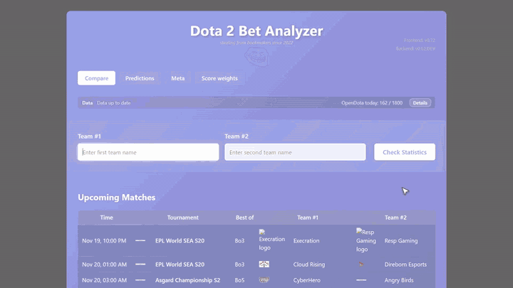
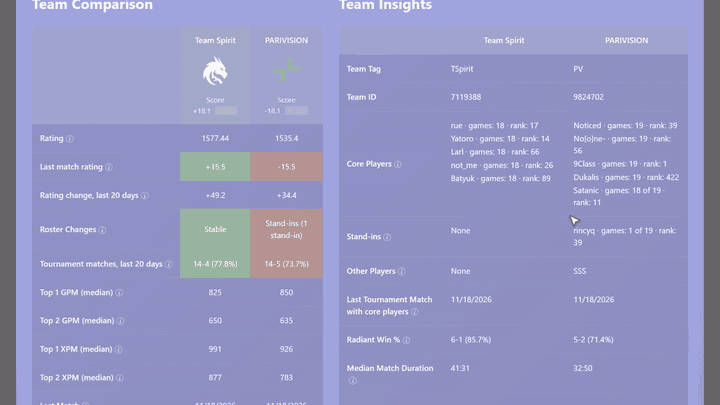
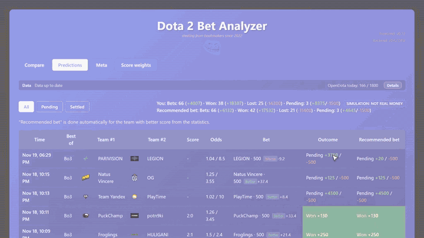
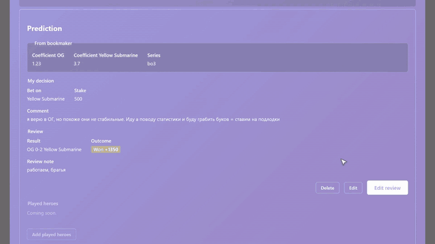
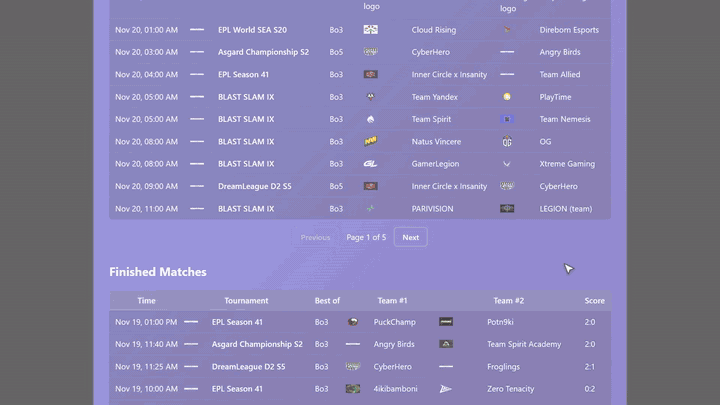

# Dota-bet-analyzer

The web application provides analytic services and highlights about the Dota 2 teams on the pro scene to help make better-informed bets.

| | |
|---|---|
| **1. Compare teams and their stats**<br> | **2. Discover their strengths and weaknesses**<br> |
| **3. Test your intuition against the recommended bets**<br> | **4. Log your observations and improve the predictions**<br> |
| **5. Don't let the crowd fool you: compare with bookmaker odds**<br> | |

**This project was created for coding learning purpose**

## Still beta? Our excuses

We know the project still has a lot of flaws:

- It runs only on your own computer, not online. We feel your pain. We're not ready to run it as a public web
  service yet, and we'll launch the site once we and the codebase are ready.
- The prediction model is far from good. It's simple, rough and uses very little math, so keep relying on your own
  brain and knowledge. It just gives you a dashboard and hints for your decisions. We're collecting data and real use
  cases to improve it.
- We built it just for fun, and it doesn't make us any money yet. If it ever does, we can put much more effort into it.
- If you found it useful, please [give us some feedback](https://github.com/iTemik/Dota-bet-analyzer/issues).

## Docs

- [Features](docs/features.md): what each page and endpoint does
- [Architecture](docs/architecture.md): services, Redis, databases, cache jobs, rate limits
- [Development](docs/development.md): setup details, tests, code quality, running single services
- [Versioning](VERSIONING.md), [frontend](frontend/README.md), [design document](https://docs.google.com/document/d/1cZAYBXYHw53i2RaiGt1aULUnfeAEof5mljG1PHHO99Q/edit?usp=sharing)
- API: Swagger UI at http://localhost:5000/api/swagger-ui while the backend runs

## 🚀 Quick Start

Prerequisites: [Python 3.14](https://www.python.org/downloads/), [Node.js LTS](https://nodejs.org/),
[Docker](https://www.docker.com/products/docker-desktop/) (for Redis) and Git.

### Windows (PowerShell)

```powershell
git clone https://github.com/iTemik/Dota-bet-analyzer.git
cd Dota-bet-analyzer
Set-ExecutionPolicy -ExecutionPolicy RemoteSigned -Scope CurrentUser   # once per machine
python -m venv .venv
.\.venv\Scripts\Activate.ps1
python -m pip install --upgrade pip
pip install -r requirements.txt
npm install
docker run -d --name redis-dota -p 6379:6379 redis:latest   # Docker Desktop must be running
npm run dev
```

### Linux (Bash)

```bash
git clone https://github.com/iTemik/Dota-bet-analyzer.git
cd Dota-bet-analyzer
python3 -m venv .venv
source .venv/bin/activate
python -m pip install --upgrade pip
pip install -r requirements.txt
npm install
docker run -d --name redis-dota -p 6379:6379 redis:latest
npm run dev
```

Next times: `docker start redis-dota`, then `npm run dev`. It applies DB migrations and starts the backend, Celery
workers and frontend; Ctrl+C stops all. Open **http://localhost:5173** (backend: http://localhost:5000).

### Common commands

| Task | Command |
|------|---------|
| Start everything | `npm run dev` |
| Run all tests | `npm test` |
| Backend / frontend only | `npm run backend` / `npm run frontend` |
| Apply DB migrations | `npm run migrate` (`npm run dev` runs it too) |
| Pre-commit checks | `python -m pre_commit run --all-files` |
| Stop Redis | `docker stop redis-dota` |

## 🆘 Troubleshooting

| Problem | Solution |
|---------|----------|
| `ModuleNotFoundError: flask/celery/redis` | Activate the venv (`.\.venv\Scripts\Activate.ps1` or `source .venv/bin/activate`) or use `npm` commands, which use the venv; reinstall with `pip install -r requirements.txt` |
| PowerShell execution policy error | `Set-ExecutionPolicy -ExecutionPolicy RemoteSigned -Scope CurrentUser` |
| Redis connection error | Check `docker ps`; start it with `docker start redis-dota` (or the `docker run` line above); port 6379 |
| Port already in use | Stop the other app on 5000; Vite moves to the next free port by itself |
| Tests fail locally | Clear caches (`Remove-Item -Recurse __pycache__, .pytest_cache` or `rm -rf __pycache__ .pytest_cache`), reinstall dependencies |
| `vitest not found` | `npm install` in the project root (installs the frontend too) |
| Page stuck on loading | Check the browser console (F12) and the `npm run dev` terminal |

# Assumptions

## Dependence on OpenDota API

It's assumed that OpenDota provides actual, correct, and complete information. If this service malfunctions, this solution becomes useless.

## Team roster calculation

It is assumed that a team roster is relatively stable. The 5 players with the most league games in the `days` window
form the roster, and those with 75% (or 50%) of the games form the core.
After roster changes, player swaps, and the addition of temporary stand-ins, statistical calculations may be inaccurate.

*Why roster comes from matches, not team membership:* teams now swap players every tournament or even monthly, so
OpenDota's team assignments are often stale. The 75%/50% shares are a temporary assumption.

## Past performance reflects current performance

It is assumed that there is no match-fixing (322) and that team performance is stable, so recently played matches can be used for statistical calculations.

# License

The code is under the [Apache License 2.0](LICENSE): free to use, change and share, also commercially, as long as
copies keep the license and the [NOTICE](NOTICE) file that credits this project.

The data the app fetches is not covered by this license and belongs to its sources:

- Teams, players, matches and heroes: [OpenDota](https://www.opendota.com) (Dota 2 data from Valve).
- Upcoming and finished series and tournaments: [Liquipedia](https://liquipedia.net/dota2/), CC BY-SA 3.0. Liquipedia
  gives betting-related projects no access to its paid API, so ask them before any public or commercial use.
- Bookmaker odds: Pari, read for personal use only; don't republish them.

Dota 2 is a trademark of Valve Corporation. This project is not affiliated with Valve, OpenDota, Liquipedia or Pari.
